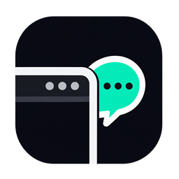
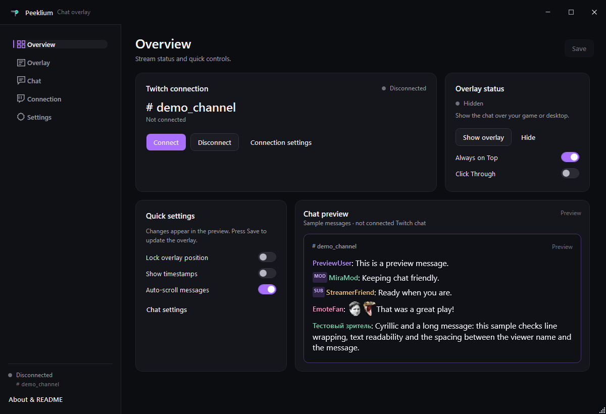
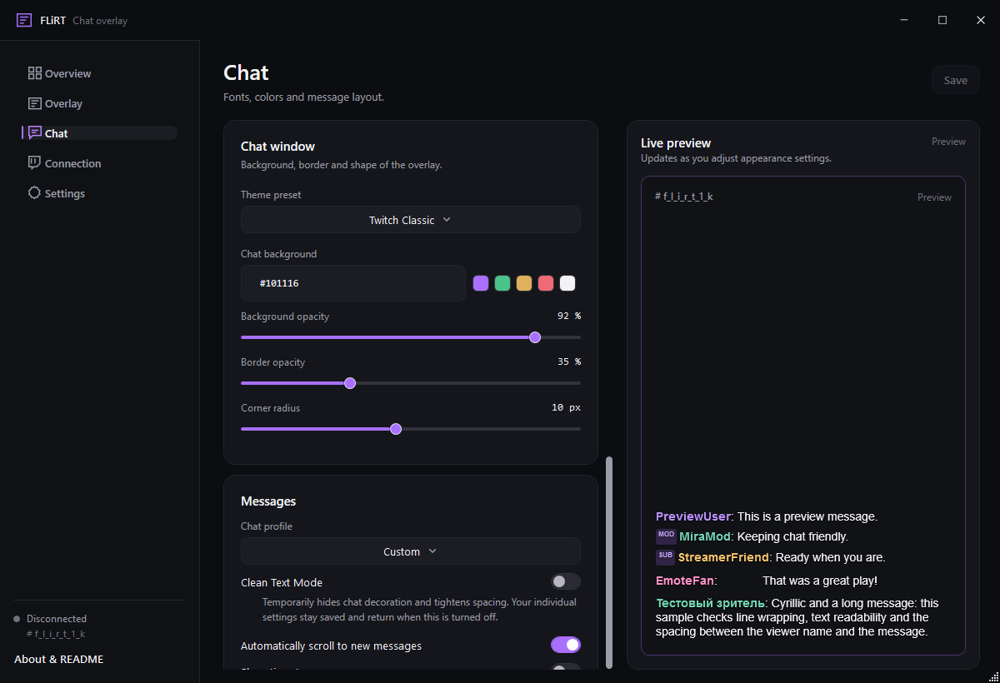
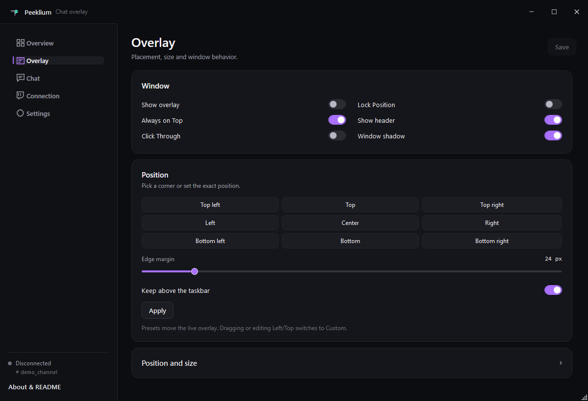
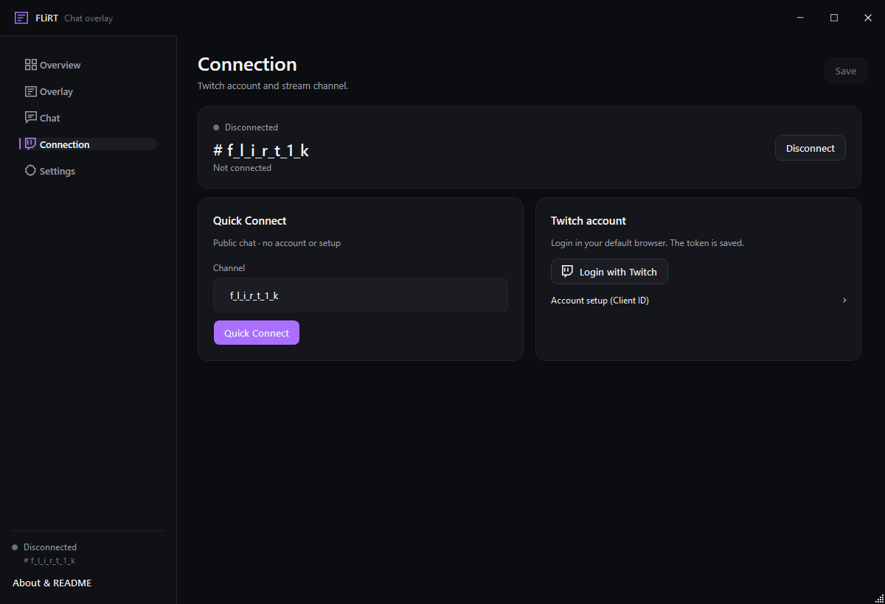

<div align="center">



# Peeklium

**Twitch chat over your game.**

A compact read-only Twitch chat overlay for Windows 10/11 x64.

[](https://github.com/LDProjectTeam/peeklium/releases)
[](https://github.com/LDProjectTeam/peeklium/releases)
[](https://dotnet.microsoft.com)
[](https://ldprojectteam.github.io/peeklium/)

[**Download for Windows**](https://github.com/LDProjectTeam/peeklium/releases/latest/download/Peeklium.exe) &nbsp;·&nbsp; [Website](https://ldprojectteam.github.io/peeklium/) &nbsp;·&nbsp; [Report a bug](https://github.com/LDProjectTeam/peeklium/issues)

<br/>

 
 

<br/>

RU [Русский](#русский) &nbsp;|&nbsp; UA [Українська](#українська) &nbsp;|&nbsp; EN [English](#english)

</div>

---

## Русский

**Twitch-чат поверх игры**

> Компактный оверлей для Windows: read-only Twitch-чат поверх игр в Borderless Windowed.

[**⬇️ Скачать**](https://github.com/LDProjectTeam/peeklium/releases/latest) &nbsp;·&nbsp; [**🌐 Сайт**](https://ldprojectteam.github.io/peeklium/) &nbsp;·&nbsp; [**🐛 Сообщить о баге**](https://github.com/LDProjectTeam/peeklium/issues)

### ✨ Возможности

| Функция | Описание |
|---------|----------|
| 🖥️ **Оверлей** | Девять позиций, изменение размера, перетаскивание, Always on Top и Click Through |
| 🎨 **Оформление** | Пресеты, шрифт, цвет, прозрачность и интервалы — предпросмотр обновляется на лету |
| 🔌 **Подключение** | Quick Connect без аккаунта или вход через Twitch |
| ⌨️ **Горячие клавиши** | Показать/скрыть чат, Click Through, настройки, блокировка позиции |
| 👁️ **Только чтение** | Показывает чат и никогда не отправляет сообщения |
| 🖥️ **Полный экран** | Работает в Borderless Windowed и оконном режиме. В некоторых играх появляется и поверх эксклюзивного fullscreen, но это не гарантируется |
| 🌍 **Языки** | Английский, русский, украинский |
| 🪶 **Портативность** | Один self-contained `.exe`, .NET Runtime не нужен |

### 🚀 Установка

1. Скачай `Peeklium.exe` со страницы [**Releases**](https://github.com/LDProjectTeam/peeklium/releases/latest)
2. Запусти файл — установщик и отдельный .NET Runtime не нужны
3. Открой **Connection**, введи свой Twitch-канал (поле по умолчанию пустое) и выбери Quick Connect или вход через Twitch
4. Настрой позицию и размер оверлея. `Ctrl+Alt+F8` показывает и скрывает чат

> **Полный экран:** надёжнее всего Borderless Windowed. Поддержка эксклюзивного fullscreen зависит от игры и драйвера.
>
> **SmartScreen:** сборка не подписана, поэтому Windows может показать предупреждение при первом запуске.

---

## Українська

**Twitch-чат поверх гри**

> Компактний оверлей для Windows: read-only Twitch-чат поверх ігор у Borderless Windowed.

[**⬇️ Завантажити**](https://github.com/LDProjectTeam/peeklium/releases/latest) &nbsp;·&nbsp; [**🌐 Сайт**](https://ldprojectteam.github.io/peeklium/) &nbsp;·&nbsp; [**🐛 Повідомити про помилку**](https://github.com/LDProjectTeam/peeklium/issues)

### ✨ Можливості

| Функція | Опис |
|---------|------|
| 🖥️ **Оверлей** | Дев'ять позицій, зміна розміру, перетягування, Always on Top і Click Through |
| 🎨 **Оформлення** | Пресети, шрифт, колір, прозорість та інтервали — попередній перегляд оновлюється одразу |
| 🔌 **Підключення** | Quick Connect без акаунта або вхід через Twitch |
| ⌨️ **Гарячі клавіші** | Показати/сховати чат, Click Through, налаштування, блокування позиції |
| 👁️ **Лише читання** | Показує чат і ніколи не надсилає повідомлення |
| 🖥️ **Повний екран** | Працює в Borderless Windowed і віконному режимі. У деяких іграх з'являється й поверх ексклюзивного fullscreen, але це не гарантується |
| 🌍 **Мови** | Англійська, російська, українська |
| 🪶 **Портативність** | Один self-contained `.exe`, .NET Runtime не потрібен |

### 🚀 Встановлення

1. Завантаж `Peeklium.exe` зі сторінки [**Releases**](https://github.com/LDProjectTeam/peeklium/releases/latest)
2. Запусти файл — інсталятор і окремий .NET Runtime не потрібні
3. Відкрий **Connection**, введи свій Twitch-канал (поле порожнє за замовчуванням) і обери Quick Connect або вхід через Twitch
4. Налаштуй позицію та розмір оверлея. `Ctrl+Alt+F8` показує й ховає чат

> **Повний екран:** найнадійніше — Borderless Windowed. Підтримка ексклюзивного fullscreen залежить від гри та драйвера.
>
> **SmartScreen:** збірка не підписана, тому Windows може показати попередження під час першого запуску.

---

## English

**Twitch chat over your game**

> A compact Windows overlay that keeps a read-only Twitch chat above Borderless Windowed games.

[**⬇️ Download**](https://github.com/LDProjectTeam/peeklium/releases/latest) &nbsp;·&nbsp; [**🌐 Website**](https://ldprojectteam.github.io/peeklium/) &nbsp;·&nbsp; [**🐛 Report a bug**](https://github.com/LDProjectTeam/peeklium/issues)

### ✨ Features

| Feature | Description |
|---------|-------------|
| 🖥️ **Overlay** | Nine positions, resize, drag, Always on Top and Click Through |
| 🎨 **Appearance** | Presets, font, color, opacity and spacing — the preview updates live |
| 🔌 **Connection** | Quick Connect without an account, or sign in with Twitch |
| ⌨️ **Hotkeys** | Show/hide chat, Click Through, settings, position lock |
| 👁️ **Read-only** | Shows chat and never sends messages |
| 🖥️ **Fullscreen** | Works in Borderless Windowed and windowed mode. Some games show it over exclusive fullscreen, but this is not guaranteed |
| 🌍 **Languages** | English, Russian, Ukrainian |
| 🪶 **Portable** | One self-contained `.exe`, no .NET Runtime required |

### 🚀 Installation

1. Download `Peeklium.exe` from the [**Releases**](https://github.com/LDProjectTeam/peeklium/releases/latest) page
2. Run it — no installer or separate .NET Runtime required
3. Open **Connection**, enter your Twitch channel (the field starts empty) and choose Quick Connect or sign in with Twitch
4. Set the overlay position and size. `Ctrl+Alt+F8` shows and hides chat

> **Fullscreen:** Borderless Windowed is the most reliable mode. Exclusive fullscreen support depends on the game and driver.
>
> **SmartScreen:** the build is unsigned, so Windows may show a warning on first launch.

---

## 🛠️ Tech stack

```text
App:       C# · .NET 10 · WPF
Overlay:   Win32 top-level window · Always on Top · Click Through
Twitch:    IRC over WSS · EventSub WebSocket · OAuth device flow
Build:     dotnet publish · single-file · self-contained win-x64
Site:      HTML · CSS · vanilla JS · EN / RU / UA
```

## 📦 Repository

This repository hosts the Peeklium landing page and Windows release builds. The app source is not published here.

---

<div align="center">
<sub>© 2026 Peeklium · LD Project · Made with ❤️ by LDProject Team</sub>
</div>
